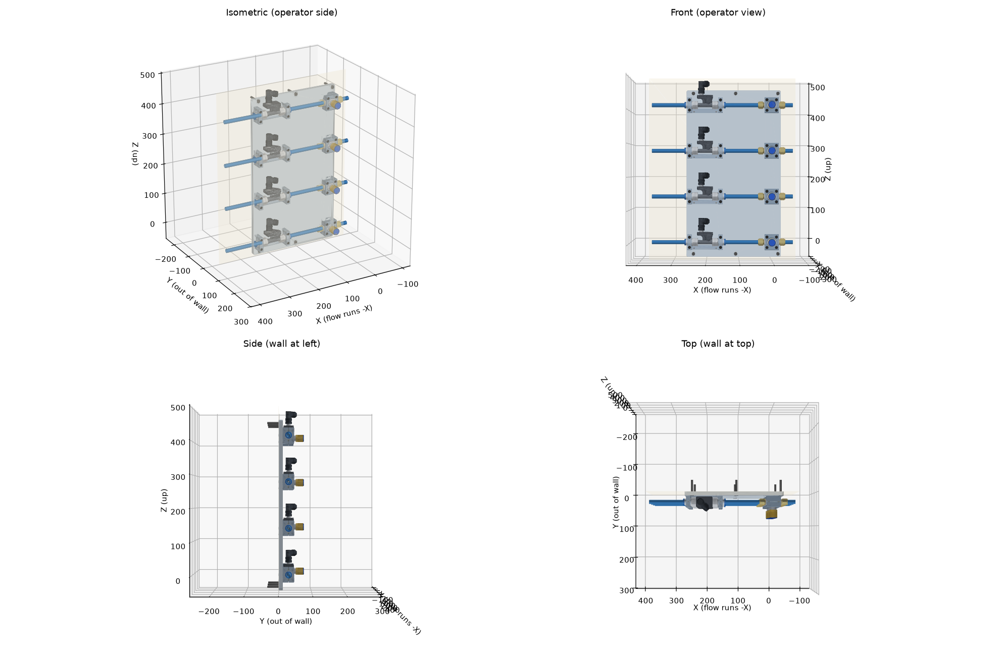

# Flow station: flowmeter and flow control valve, four sets stacked on the wall

Parametric CAD (Python, [build123d](https://github.com/gumyr/build123d)) for a
small wall-mounted water station. Water passes through an ifm SV3051 vortex
flowmeter, a short straight 12 mm tube, and a needle valve. Seen from the
front, flow runs left to right:

```
inlet tube → ifm SV3051 flowmeter → 140.3 mm link tube → RS 283-8289 needle valve → outlet tube
```

Both components sit in 3D-printed PETG clamps on one 12 mm acrylic plate,
which screws to the wall. Four identical sets are stacked one above the
other, 140 mm apart, all on that one plate (`assembly.STACK_N`,
`assembly.STACK_PITCH`).

[](https://3dviewer.net/#model=https://raw.githubusercontent.com/zhuming15/cooling_system_cad/main/output/step/00_flow_station_assembly.step)

[Open the assembly in a 3D viewer](https://3dviewer.net/#model=https://raw.githubusercontent.com/zhuming15/cooling_system_cad/main/output/step/00_flow_station_assembly.step)
(runs in the browser; it loads `output/step/00_flow_station_assembly.step` from
`main`, so it shows the last pushed version).

Contents: [Ratings](#ratings) · [Bill of materials](#bill-of-materials) ·
[Manufacturing](#manufacturing) · [Assembly](#assembly) ·
[Tests on real parts](#tests-on-real-parts) ·
[How the design works](#how-the-design-works) · [Open items](#open-items) ·
[Part data sources](#where-the-part-dimensions-come-from) ·
[Working with the code](#working-with-the-code) ·
[Maintaining the design](#maintaining-the-design)

## Ratings

| | |
|---|---|
| Medium | Water |
| Pressure | 6 bar max (limited by the Festo QSF fittings) |
| Water temperature | 0–40 °C (limited by the SMC KQ2 fittings) |
| Flow measured | 0.5–10 l/min (SV3051) |
| Tube | 12 mm OD × 8 mm ID, PU or PA |
| Station size | One 289.4 × 512 × 12 mm plate for the stack of 4 (140 mm pitch); 78 mm deep from the wall to the valve knob |

The valve itself is rated 210 bar and the meter 16 bar. Don't use those
numbers for the station.

## Bill of materials

`output/step/bom.csv` is generated from the model and lists every part with
its STEP file, with quantities for the whole stack of four sets. The
quantities in the tables below are **per set**; order four times as many,
except the station plate and its 6 M6 wall screws: those are for the whole stack.

### Bought-in parts

| Part | Qty | Model |
|---|---|---|
| ifm SV3051 vortex flowmeter, G1/2 male both ends | 1 | `flowmeter/flowmeter.py` |
| Amphenol LTW MSAP-04BFFC-SR7001, A-coded M12 elbow | 1 | `flowmeter_electronic_interconnect/flowmeter_electronic_interconnect.py` |
| Festo QSF-1/2-12-B push-in fitting, G1/2 female × 12 mm tube | 2 | `flowmeter_connector/flowmeter_connector.py` |
| RS PRO 283-8289 needle valve, G1/4 (made by Tognella, FT 1251/2-01-14) | 1 | `valve/valve.py` |
| SMC KQ2H12-U02A push-in fitting, 12 mm tube × G1/4 male | 2 | `valve_connector/valve_connector.py` |
| G1/2 flat sealing washer, OD ≤ 18.6, ID ≥ 11.5, about 1 mm, FKM or EPDM (see [Open items](#open-items)) | 2 | |
| 12 × 8 mm tube: link 140.3 mm cut square, plus inlet (≥ 100 mm straight) and outlet | | |

### Made parts

| Part | Qty | Process | File |
|---|---|---|---|
| Station plate | 1 for the stack | CNC-routed 12 mm cast acrylic, 289.4 × 512 mm: through-cuts plus two 6 mm pocket features | `flowmeter_clamp/base_plate.dxf` |
| Valve clamp base | 1 | FDM print, PETG | `output/step/06_valve_clamp_base.step` |
| Valve clamp cap | 1 | FDM print, PETG | `output/step/07_valve_clamp_cap.step` |
| Flowmeter clamp base (both pedestals and the lower bar, one piece) | 1 | FDM print, PETG | `output/step/08_flowmeter_clamp_base.step` |
| Flowmeter strap | 2 | FDM print, PETG | `output/step/09_flowmeter_clamp_strap.step` |

### Hardware

| Part | Qty | Where | Torque |
|---|---|---|---|
| Dowel pin ISO 8734, Ø4 m6 × 12 | 4 | Locate each clamp base on the plate | |
| ISO 4762 M4 × 16 and M4 × 12 | 2 + 2 | Clamp bases to the plate | 0.2 N·m |
| ISO 4032 M4 nut | 4 | Captive in the plate | |
| ISO 4762 M4 × 20 + DIN 125 washer | 4 | Valve cap | 0.5 N·m |
| ISO 4762 M4 × 25 + DIN 125 washer | 4 | Flowmeter straps | 0.55 N·m |
| Heat-set insert M4 × 8.1 (ruthex RX-M4x8.1 or equal), Ø5.6 hole | 8 | In the clamp bases | |
| M6 socket head screw + wall plug | 6 for the stack | Plate to the wall (not per set) | |

## Manufacturing

### Station plate

- One plate of 12 mm cast acrylic, 289.4 × 512 mm, carries all four sets:
  each set's holes, pockets and wall slots are repeated at 140 mm. The DXF is in mm,
  one layer per feature. Regenerate it with
  `uv run python flowmeter_clamp/flowmeter_clamp.py`.
  - `CUT`: through-cuts. Outline, M6 wall slots, Ø4.1 dowel holes, Ø4.5 M4
    holes.
  - `POCKET_WALL_FACE`: 7.2 AF hex pockets for the M4 nuts, 6 mm deep from
    the wall face.
  - `POCKET_FRONT_FACE`: Ø11.5 counterbore slots for the M6 heads, 6 mm deep
    from the front face. The heads end flush with the front face.
- Make the whole plate on a CNC router: the pockets are stepped holes, and
  a laser leaves Ø4–4.5 holes visibly tapered through 12 mm of acrylic,
  which would spoil the dowel slip fit. Drill or ream the dowel holes. Keep
  each pocket floor flat, because the M4 nut bears on it.
- Cut all the dowel holes in one job. The two clamps of a set are only
  coaxial if their dowel holes come from the same cut, and the sets stay
  140 mm apart.
- The M4 nuts go into the hex pockets from the wall side before the plate
  goes on the wall; the wall then traps them.
- The design assumes ±0.1 mm on hole positions. Cut the calibration coupon
  first (test 2 below).

### Printed parts

- PETG. Walls are at least 1.2 mm, which is 3 perimeters with a 0.4 mm nozzle.
- Print orientation:
  - clamp bases and the valve cap: the wall-side face on the bed;
  - straps: on their end face.

  In that orientation nothing needs support: the longest bridge is under
  15 mm, and the only curved overhangs are holes up to Ø10.
- Every part fits a 250 mm bed. The largest is the flowmeter clamp base,
  120 mm long.
- The STEP files in `output/step/` are not rotated into print orientation.
  Lay them on the face given above in the slicer.
- The caps and straps are exported in their as-printed position. In
  service, they close 0.15 mm further onto the part they clamp.
- The design assumes ±0.2 mm on printed features. The 1.0 mm gap between
  each cap or strap and its base is sized for that. Print the coupon first
  (test 3 below).
- Press 2 dowel pins into each clamp base. Set the M4 inserts into its split
  face with a soldering iron.

## Assembly

1. **On the bench:**
   - Screw both KQ2 fittings into the valve with a 19 mm spanner.
   - Screw both QSF fittings onto the flowmeter, each with a flat G1/2
     washer. Hold the meter by its 12 mm flats, and tighten to 12 N·m at
     most: the meter body is plastic.
   - Align and connect the A-coded MSAP electrical elbow from above. The
     exact parts were dry-fitted successfully by the user; see the CAD note below.
   - Push the 140.3 mm link tube fully home into the flowmeter outlet QSF
     and the valve KQ2, with the parts lying straight. The flow arrow on the
     meter must point at the valve.

   The link tube is cut exactly stop-to-stop, so it can't be fitted once
   both parts are clamped. That's why the meter, tube and valve go in as one
   unit.
2. Screw the one plate to the wall with 6 × M6: three along the bottom edge,
   three along the top, outside the sets. The vertical slots give ±3 mm of
   adjustment and move every clamp together. The four
   sets sit 140 mm apart on it; any set's clamps, bench unit and hardware
   can be fitted, serviced or removed with the other sets in place.
3. Push each clamp base onto its dowel holes and fix it with 2 × M4 through
   the channel floor at **0.2 N·m**. This torque has a narrow window: at
   0.15 N·m the valve base can tip under a hard tube pull; at 0.3 N·m the
   nut starts to crush the acrylic.
4. Lower the bench unit into both clamp bases at once, with the meter's
   housing and M12 connector on top and the valve knob facing out.
   - The fitting hexes can sit at any angle; the straps grip the round body
     next to the hex.
   - Hold the meter level (housing straight up) while you tighten the
     straps; strap friction alone keeps it there (there is no roll-stop pad).
5. Fit the valve cap with 4 × M4 × 20 and washers, and the two straps with
   M4 × 25 and washers. Tighten the valve cap to **0.5 N·m** and flowmeter
   straps to **0.55 N·m**. Re-check after 24 h.
6. Push in the inlet and outlet tubes. Keep at least 100 mm of straight tube
   ahead of the meter, and support the tubes beyond the station.

## Tests on real parts

The model is checked in software (see [Design checks](#design-checks)). These
tests need the real parts, in this order:

| # | Test | How | Pass when |
|---|---|---|---|
| 1 | Measure the bought-in parts | Calipers on the valve body (18 × 18, chamfers, port chamfer), the QSF round body (Ø20.8 × 11; port face → hex end 18), the KQ2 hex, and the meter's end faces | Within 0.1 mm of the model; otherwise update the part file and re-run the checks |
| 2 | Plate coupon | Cut a 12 mm strip with Ø4.1 dowel holes, Ø4.5 holes, a 7.2 AF hex pocket 6 mm deep and an Ø11.5 counterbore 6 mm deep at the plate spacing; measure the sheet | Dowel slides in with no play you can feel; nut drops in, doesn't turn and sits flat on the pocket floor; M6 head ends flush; sheet 10.8–13.2 mm |
| 3 | Print coupon | Print a 20 mm slice of each clamp (channel, bore, dowel hole, insert hole) | Valve body and QSF body slide in with slight drag; dowel presses in with a hand vise; insert sets square |
| 4 | Insert pull-out | M4 into a set insert in the coupon, pull | Holds about 1.9 kN (3 × the 625 N screw preload) |
| 5 | Dry fit | Assemble without tightening | Every step goes in by hand; the bench unit drops into both bases without forcing the tube |
| 6 | Clamp gap | Feeler gauge at the split faces of the cap and both straps after tightening | Gap still open at all four corners (model: 0.85 mm) |
| 7 | Leak | Fill with water, 6 bar, hold 30 min | No pressure drop, no weep at the threads or tubes |
| 8 | Torque retention | Re-check all M4 after 24 h and after 1 week | Less than about 30 % loss; otherwise add wave washers |
| 9 | Pull and twist | 500 N axial pull on the outlet tube; 50 N sideways on the M12 cable | Nothing moves; the meter stays level |
| 10 | Valve use | Open and close the valve fully 20 times | The valve doesn't turn or shift in its clamp |
| 11 | Thermal | Run with water at 5 °C and at 40 °C, an hour each | No leaks, no visible tube bow, clamps still tight |
| 12 | Alignment | With the straps loose, sight along the link tube, then tighten | No visible bend, and the meter doesn't jump (model worst case 1.24 mm offset) |

## How the design works

- **Meter upstream of the valve.** The valve keeps the meter under
  back-pressure, which ifm asks for to avoid cavitation, and the valve's
  turbulence stays downstream of the measurement. The meter is directional
  (arrow on the pipe). The valve is not: Tognella's datasheet shows it
  double-acting, so either port can be the inlet. (RS's product text says
  "single-acting"; that is wrong.)
- **Straight runs.** ifm wants at least 15 × DN = 90 mm of straight pipe
  before and after the meter, and advises against mounting it directly in
  front of a valve (manual 11592037, sec. 4). The link tube has 100 mm of free straight length.
- **Meter position.** Pipe horizontal, housing and M12 connector on top:
  ifm's recommended position (manual Fig. 1). The plate hangs on the wall
  with the pipe parallel to it.
- **Modular clamps.** The plate has only holes and two kinds of 6 mm pocket. Each clamp base is located
  by 2 steel dowels and held by 2 M4 into captive nuts. Its cap or straps
  screw into heat-set inserts in the base. The base screws sit under the
  channel floor, so they are reachable until the component goes in.
- **Valve clamp.** The square valve body sits in a channel split between
  base and cap. The halves stop 1.0 mm short of each other, more than the
  2 × 0.2 mm print tolerance, so the cap always bears on the valve, not on
  the base. The knob comes out through a Ø27.5 hole in the cap.
- **Flowmeter clamp.**
  - The straps grip the round Ø20.8 body of each QSF fitting, never the hex.
    How far a fitting turns when it is tightened decides where its hex ends
    up, so the hex angle can't be controlled. A check spins each fitting
    through a full hex pitch to prove any angle fits.
  - The two strap bores alone set the meter's height.
  - The meter's angle is set by hand when the straps go on, and strap
    friction holds it (×5 against a 50 N cable pull). There is no roll-stop
    pad (removed 2026-11-25: the straps stabilise the meter).
  - The base is two pedestals joined by one lower bar against the plate;
    the concave joints are filleted and the two dowels go through the bar.
    In a stack, the lifted M12 elbow has 20.4 mm to the set above.
  - All clamp load goes through the brass fittings, so tube loads never pass
    through the meter's plastic threads.
  - The QSF fittings are tightened on the bench, with the meter held by its
    flats. The printed straps are not meant to take the thread torque.
- **No strain on the link tube.** The tube must be straight, with no side
  offset and no axial load:
  - Both clamp bases locate on dowel holes cut in one pass in the same
    plate, and both flowmeter pedestals are one printed part. At worst-case
    tolerances (print ±0.2, laser ±0.1), the side offset is 1.24 mm. That
    bends the 100 mm free tube by 0.45 %, under the 0.5 % limit.
  - Valve and meter sit on their cradle floors with the same 0.15 mm
    clearance, so both axes are the same distance from the wall.
  - The tube is cut stop-to-stop. The 12 mm straps sit 1 mm off the QSF hex cone and overhang the smaller collar; they allow ±1.0 mm of axial float:
    push the tube home first and tighten the straps after, and the meter
    settles where the tube puts it.

### Tight margins

These pass, but with little room. Re-check them after any change nearby:

- Worst-case link-tube strain: 0.45 % against a 0.5 % limit.
- Valve clamp base against tipping under a 500 N tube pull: × 1.17.
- Clamp-base screw torque: 0.2 N·m (0.15 lets the valve base tip; 0.3
  overloads the acrylic).
- Contact pressure: flowmeter strap washer on PETG 14.0 MPa (limit 15);
  valve washer 12.7 MPa; nut on acrylic 9.4 MPa (limit 10).
- Elbow cable pull: ×5.11 holding margin against the required ×5 at 50 N.
  Straps need 0.55 N·m: 0.5 fails that margin; 0.6 overloads the PETG washer seat.
  Friction, torque-to-preload and plastic allowables remain engineering estimates.
- Flowmeter strap axial float: ±1.0 mm against a ±1.0 mm minimum. The
  real QSF round body is only 11 mm long (caliper), shorter than the 12 mm
  strap; the strap sits 1 mm off the hex cone and overhangs the collar
  (Ø19.3, estimated; it must stay under the Ø20.95 bore).
- Flowmeter strap counterbores: Ø9.5 in the 12 mm strap leaves 1.25 mm side
  walls against the 1.2 mm (3-perimeter) minimum.
- Wall screws: 6 × M6 carry the whole stack, 88 N per screw against a 100 N
  plasterboard-plug limit under a 500 N tube pull (4-set stack, 4.3 kg). Four
  screws would be 129 N; into masonry or a stud the limit is much higher.

## Open items

- **Seal at the meter's end faces.** The design uses a flat G1/2 washer
  between the meter and each QSF fitting. ifm's 3D model shows a seal-ring
  groove in each end face (ID 12.85, OD 16.75, 1.2 deep). With that groove,
  a flat washer only bears on two narrow lands, Ø11.7–12.65 and Ø16.95–18.4.
  Check on a real meter, or in ifm manual 11592037, whether it ships with
  seal rings in the grooves before ordering washers.
- **QSF washer thickness.** The QSF position comes from the washer: the
  model assumes 1.0 mm (`FC.WASHER_T`). Measure the fitted washer; a
  different thickness moves both fittings and the straps by the difference.
- **Material values are estimates** (no single source): PETG 15 MPa and
  acrylic 10 MPa allowable contact pressure, friction 0.3 PETG on brass,
  print ±0.2 mm, laser ±0.1 mm, tube strain limit 0.5 %, tube expansion
  150e-6/K, PETG heat limit 70 °C, 100 N per wall plug. The clamp gaps,
  pressures and strain checks depend on them; the coupons and tests above
  confirm them.
- **M12 cable route in the stack.** The cable leaving each elbow is not
  modelled. It points toward the operator and downstream. Route it so it
  doesn't hang over the valve knob of the set below.
- **Valve port chamfer.** The KQ2 gasket seats on the chamfer of the female
  thread (SMC catalogue). Check that the valve ports have one.
- **Load cases** (500 N tube pull, 50 N cable pull, plasterboard wall) are
  engineering judgement agreed with the owner, not from a standard.

## Where the part dimensions come from

Every bought-in part is modelled from its vendor's data and compared with the
vendor's own 3D model by `tools/cad_compare.py`. Features that something
touches (threads, sealing faces, clamped diameters, spanner flats) must match
within 0.02 mm; the rest of the outline within 0.5 mm.

| Part | Sources | Result |
|---|---|---|
| ifm SV3051 | ifm datasheet SV3051-00, ifm STEP CAD_STP_300_0358, manual 11592037 (torque 12 N·m, straight runs, orientation) | All dimensions read off the STEP. G1/2 ends, end-face groove, shoulder, bore, 16 AF hex and 12 AF flats within 0.001 mm; outline within 0.32 mm. The datasheet lists a display; this unit has none, so none is modelled |
| Festo QSF-1/2-12-B | Festo datasheet 190653, RS/TraceParts 3D model, user caliper measurements (2026-11-25) | **Caliper values override the RS model**: length 40, port face → hex end 18, round Ø20.8 section 11, ring end zone 11; on the meter with washers the port faces are 45 apart, so the port floor is 17 deep (16 + 1 mm washer, washer thickness estimated). The RS model (hex 21, round 15.3, 40.8 long) no longer matches, so `cad_compare.py flowmeter_connector` fails on the outline. The meter has no shoulder that stops the QSF: it bottoms on the end face. Insertion depth 23.3 mm (datasheet) |
| SMC KQ2H12-U02A | SMC KQ2 catalogue, RS/TraceParts 3D model | Thread, undercut, seal face and hex within 0.001 mm |
| RS 283-8289 valve | Tognella FT 1251/2-01 datasheet, table type 14 | Body 18 × 18 × 46, G1/4 ports 12 deep, M17×1 bush, Ø22 knob, height 57 from the table. Edge chamfer 2.5, boss 18 × 2.5 and the back groove scaled from the drawing (±0.3 mm). No vendor 3D model exists |

The comparison images are in each part folder (`cad_check.png`,
`drawing_check.png`).

### Electrical connector assembly

`flowmeter_electronic_interconnect/` models the Amphenol LTW
**MSAP-04BFFC-SR7001**, M12 A-coded, four female crimp contacts, right-angle
plastic housing. It is placed on the SV3051 and counted once in the station
BOM. Its sources and dimensions are in the
[dimension register](flowmeter_electronic_interconnect/dimension_register.md).
The A- and D-coded drawings share the 39.3 mm length, 35.5 mm height,
Ø18.6 coupling and 16 mm spanner reference dimensions. This model uses the
A-coded variant's own STEP, including its key and contact geometry.

The complete ribbed CAD envelope is 39.5486 × 19.0 × 36.5 mm. The drawing's
reference dimensions exclude some grip extremes. Internal wiring space is
filled, threads are cosmetic, and small housing blends and lettering are
simplified. The drawing overlay is retained beside the model.

| Verified item | Result against OEM A-coded STEP |
|---|---|
| A-coded insert, four socket contacts and seal | Surfaces in both directions and feature edges within 0.001 mm |
| Connector and gland spanner flats | Surfaces in both directions and feature edges within 0.001 mm |
| Exterior envelope | Vendor→model 0.292 mm; model→vendor 0.414 mm (limit 0.5 mm) |
| Female M12 thread | Cosmetic major-diameter bore; documented convention skip |
| Internal wiring space | Filled envelope; omitted vendor internal faces reported separately |

`cad_compare.py` reports **PASS** (15,000 vendor surface points, 40,327 model
surface points and 4,843 functional feature-edge samples). No fit-critical
dimensions require estimated or scaled values. The standalone-stage 52-test suite passed;
the 16 component/vendor-tool tests passed again after the final gland-edge
correction. Those results describe the standalone component, before mating.
The assembled station is verified by **78 design checks** and **108 pytest tests**,
including negative tests for plug displacement, wrong key phase, insertion
obstructions, insufficient strap torque and excessive PETG bearing pressure.

**Mated CAD discrepancy:** Amphenol's insert is Ø8.20 mm and ifm's socket is
Ø8.15 mm. At nominal coaxial placement this creates about 5.00 mm³ of overlap
(0.025 mm radially). **The user confirmed that these exact physical parts fit
together on 2026-11-23.** Both vendor geometries are preserved. The all-pairs
check accounts only for this source-defined cylindrical skin at this one
mating pair; any overlap outside it still fails the original 0.001 mm³ limit.
A negative test displaces the insert and proves this does not hide misalignment.

Placement aligns the A-code key at the ifm CAD's −45° phase and locates the
uncompressed seal tangent on the M12 top face (Z42.25). This puts the plug
shoulder datum at Z43.75; no seal-compression estimate is imposed. The cable
outlet points diagonally downstream and toward the operator. No cable routing
is modeled. The plug joins the flowmeter bench unit; insertion from above is
checked separately against the surrounding station. Cable pull uses the
cable-entry centre measured from the placed gland: 67.12 mm radial distance
from the flow axis, including both Y offset and Z height. At 0.55 N·m strap
torque, estimated holding torque is 17.16 N·m against 3.36 N·m from the 50 N
pull (×5.11). Maximum washer pressure is 14.0 MPa against the 15 MPa PETG
allowable. No clamp geometry or check threshold was changed.

`output/flowmeter_fitted.step` and `output/flowmeter_fitted.png` show the
flowmeter with its electrical elbow and both QSF fittings. The full station
export and BOM also include the connector.

Use cable OD 4–7 mm per drawing rev F; the product page's 4–8 mm claim is
unresolved. No A-variant tightening torque was verified. These limitations
and the electrical/material ratings are recorded in the dimension register.

```bash
uv run python tools/export_interconnect.py  # standalone named STEP and two-view PNG
uv run python tools/cad_compare.py flowmeter_electronic_interconnect/cad_spec.json <OEM-A-STEP>
uv run python tools/drawing_check.py flowmeter_electronic_interconnect/drawing_spec.json <OEM-A-drawing-PDF>
```

## Working with the code

### Setup

Needs Python 3.12 and [uv](https://docs.astral.sh/uv/).

```bash
uv sync
```

### Commands

```bash
uv run python assembly.py           # build the station, run the design checks (~1 min)
uv run pytest                       # full suite, 4 isolated workers
uv run pytest -n 0                  # serial debug (-m "not slow" for quicker feedback)
uv run python tools/export_step.py  # output/step/: one STEP per part, assembly STEP, bom.csv
uv run python tools/render.py       # output/assembly.png, output/components.png
uv run python flowmeter_clamp/flowmeter_clamp.py   # plate DXF + flowmeter clamp sizes
uv run python valve_clamp/clamp.py                 # valve clamp sizes
uv run ruff check .
```

To look at the model interactively, start the standalone OCP CAD viewer
with `uv run python -m ocp_viewer`, open http://127.0.0.1:3939/viewer, then:

```bash
uv run python tools/view.py            # whole station
uv run python tools/view.py exploded   # pulled apart in assembly order
uv run python tools/view.py flowmeter  # or valve, connector, base, cap, flowmeter_connector, flowmeter_fitted
```

### Repository layout

```
assembly.py            places every part, runs the design checks, writes output/
valve/                 needle valve model
valve_connector/       SMC KQ2 fitting model
valve_clamp/           valve clamp base + cap; shared constants (tolerances, hardware)
flowmeter/             ifm SV3051 model
flowmeter_connector/   Festo QSF fitting model
flowmeter_clamp/       flowmeter clamp base + straps; station plate and its DXF
tools/checks.py        reusable check library (interference, access, stacks, loads, printing)
tools/export_step.py   STEP export and BOM
tools/render.py        PNG renders
tools/view.py          send the model to the OCP CAD viewer (ocp_viewer)
tools/cad_compare.py   compare a part model with the vendor's 3D model
tools/drawing_check.py overlay a part model on its datasheet drawing
tools/fetch_rs_cad.py  unpack an RS website 3D model
tests/                 pytest
output/                generated, don't edit: STEP files, BOM, renders
```

Each part file has its dimensions as named constants at the top, each with
its source, and `make_*()` functions that return the solid. The clamps are
sized from the part constants, so a corrected part dimension carries through
to the clamps.

Coordinates: the wall is Y = 0 with +Y out of the wall, Z is up, and the
flow axis runs along X, 30 mm from the wall. Flow goes towards −X, which is
left to right for someone facing the wall. Units are mm. Each part file's
docstring gives its own local frame.

### Design checks

`assembly.py` prints PASS or FAIL for each check and exits non-zero if any
fail. The checks cover:

- interference between every pair of parts;
- clamping: each cap or strap closes on its part before it reaches the base,
  slip and rotation resistance, and contact pressure on the plastics;
- tool access to every screw, and operator access to the knob, the release
  collars and the M12 plug;
- fitting engagement, seal seating and flow direction (read from the placed
  geometry, so a meter mounted backwards fails);
- link-tube alignment and strain: worst case, RSS, Monte Carlo and thermal;
- the flowmeter clamp at every fitting hex angle;
- screw preload, tipping under a 500 N tube pull, wall-screw loads;
- that every assembly step can move into place in order without a collision;
- printability: no support needed, sampled wall thickness, bed size.

`uv run pytest` runs the same checks as tests. It also breaks the design on
purpose (meter mounted backwards, link tube fitted last, looser tolerances)
and checks that the matching check fails.

The accepted check inventory is `tests/check_inventory.json`: each check has a
stable `STATION-nnn` identifier, its section and its report name. Pytest rejects
missing, duplicate or unexpected checks. Change the inventory explicitly when
an engineering requirement changes; do not regenerate it merely to pass a test.
Negative tests target individual failure modes, including contained collisions,
false tubes with the correct bounding box, and obstacles between the former
motion snapshots. This is targeted fault coverage, not a claim that all 76
requirements have a separate negative case.

Collision pruning uses inclusive box intersection, including containment.
All-pairs bounds are calculated once per invocation; no global geometry cache
survives a changed model. The measured interference section fell from 14.31 s
to about 1.9 s with the corrected containment rule and cached bounds.

Insertion checks cover motion intervals rather than only positions 1 mm apart.
They use exact swept occupancy for axial hardware, conservative sliced bounds
for sliding contacts, and adaptive distance/volume bounds elsewhere. The
0.001 mm³ interference limit is unchanged. A calculation budget limits adaptive
work per pair; an unresolved interval fails and is labelled uncertified.
The reported distance is a collision witness or unresolved interval, not an
exact first-contact measurement. Fitting rotation uses conservative full-turn
envelopes and invariant round seating faces, including angles between the
former 7.5° snapshots.

The tube check reads its cylindrical walls, bore and planar ends directly from
the B-rep. Wall thickness remains a sampled estimate: the report gives usable
rays and measured faces, and incomplete face coverage fails. It does not prove
a global minimum between samples; print coupons and physical inspection remain
required. Vendor comparisons also fail if a required fit zone has no surface
measurements on either model, or if zone definitions are invalid.
Exact B-rep face-interior samples fill fit zones missed by tessellation vertices;
vendor preview meshes still use only their original measured vertices.

For quick work on the reusable tools, use
`uv run pytest tests/test_checks.py tests/test_vendor_tools.py`. The broader
`uv run pytest -m "not slow"` also builds the station for selected negative
tests. Holding-load calculations are separate from geometric fitting checks,
and the tube-last negative test isolates that impossible installation step.
The complete suite and release workflow below remain required.


The default parallel run uses four separate pytest processes, each with its own
session-scoped assembly. Long assembly-order and printability checks start early;
a short test follows each to accommodate xdist's next-item reservation.
`--maxschedchunk=1` keeps later work distributed. Override with `-n 0` for serial
debugging or `-n 2` on smaller machines.

Stack collision, tool and service queries share a `GeometryQueries` context for
one check invocation. Bounds are reused for unchanged shapes; moves and wrapped
shape replacements invalidate automatically. The context retains strong shape
references and is discarded after the check. Direct low-level OCCT topology
edits require `invalidate(shape)` or a new context. There is no global cache.

Acceptance motion queries request `first_failure=True`: a collision or an
uncertified interval already fails that query, so later pairs add no acceptance
information. Passing queries still certify every candidate pair, and every
report check still runs. Call `sweep()` with its default `first_failure=False`
for all collision pairs. Distance queries use actual solids to detect parts
fully enclosed in compound wrappers; numerical limits are unchanged.

Reproduce the configuration experiment with
`uv run python tools/benchmark_tests.py` (three full runs each with serial, two
and four workers). It writes subprocess wall times, logs, JUnit reports and a
plot under `benchmarks/test-runtime/`. The reported 742-second earlier run is
labelled as user-reported; it is not a controlled baseline. Nine measured full
runs passed all 104 tests: medians were 94.00 s serial, 51.98 s with two workers,
and 52.36 s with four. A controlled stack profile with only bounds reuse disabled
versus enabled fell from 56.82 s / 20,440 bounds calculations to 2.10 s / 411.
See `benchmarks/README.md` for logs, methodology and plots. To isolate bounds
reuse on identical code, run `tools/profile_stack.py --output <file.json>` once
normally and once with `--uncached`, in separate processes with no other CAD
jobs running.

## Maintaining the design

### After any geometry change

1. `uv run python assembly.py` must end with `ALL CHECKS PASS`. If a check
   fails, fix the design. Don't loosen a limit or delete a check to get a
   pass; if a check is wrong, fix the check and say why in the commit.
2. `uv run pytest` must pass. A new or changed check needs a negative test
   in `tests/test_assembly.py` that breaks the design and expects that check
   to fail.
3. Run `tools/export_step.py` and `tools/render.py` (and
   `flowmeter_clamp/flowmeter_clamp.py` if the plate changed), then look at
   `output/assembly.png` and `output/components.png`. A passing check can
   still hide a wrong shape.
4. `uv run ruff check .` must be clean.
5. Commit and push `output/` with the change, so the online viewer and the
   manufacturing files match the code.

### Replacing or correcting a bought-in part

- Every dimension must come from a datasheet, catalogue or vendor 3D model,
  and its constant says which. Mark anything else `ESTIMATE` in the code.
- If you measure a real part with calipers, change the part file, not the
  clamp. The clamps resize from the part constants.
- Re-run the vendor comparison and look at the image it writes:

  ```bash
  uv run python tools/cad_compare.py flowmeter <ifm STEP file>
  uv run python tools/drawing_check.py flowmeter <SV3051 datasheet pdf>
  ```

  Presets exist for `valve_connector`, `flowmeter_connector` and
  `flowmeter`. Keep downloaded vendor files outside the repo; only the
  comparison images are kept here.
- Where to get the vendor data:
  - ifm publishes the SV3051 datasheet, manual 11592037 and STEP model on
    the product page (Downloads tab).
  - RS product pages block scripts; open them in a browser. Datasheet PDFs
    on `docs.rs-online.com` download normally.
  - RS's 3D viewer models are simplified TraceParts meshes, solid inside and
    without bores: good for the outline only. `tools/fetch_rs_cad.py`
    unpacks one; its docstring explains how to get the link.

### Adding a part to the station

- Give it a `make_*()` function in its part file, and add it in
  `assembly.build()` with a name that follows the existing pattern
  (`valve_knob`, `fm_clamp_strap_0`, `m4_nut_*`, ...). The checks, the
  colours in `tools/render.py`, the exploded view in `tools/view.py` and
  `tools/dims.py` all look parts up by name.
- Add it to an assembly step in `assembly.ASSEMBLY_ORDER`, or the
  assembly-order check fails.
- Add it to `SUBASSEMBLIES`, `components()` and `QTY_PATTERN` in
  `tools/export_step.py`, or the export fails.

### Rules that keep the design working

- Never clamp or locate on a fitting's hex: its angle depends on how tight
  the thread is. Clamp on round features and take angles from features on
  the part body.
- The link tube must stay straight and unstrained: both clamp bases dowel
  into the same plate, the valve and meter pocket clearances stay
  equal, and the tube length comes from the two tube stops, never a typed
  number.
- Threads are modelled without helices: female threads at the major
  diameter, screw threads at the minor diameter, so threaded joints don't
  show as interference.
- Screws go into heat-set inserts (printed parts) or captive nuts (plate),
  never into tapped plastic. Keep contact pressures under the PETG and
  acrylic allowables in `valve_clamp/clamp.py`.
- Caps and straps are modelled in two positions: clamped (in the assembly)
  and as printed (for export). The 1.0 mm split gap must stay larger than
  the clamp travel plus twice the print tolerance.
- Part folders are not Python packages. Scripts add the repo root and part
  folders to `sys.path`; keep that pattern.
