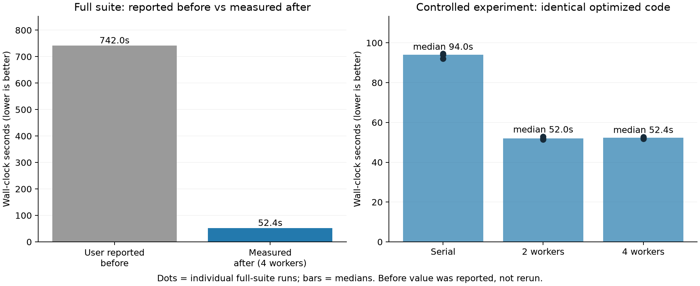
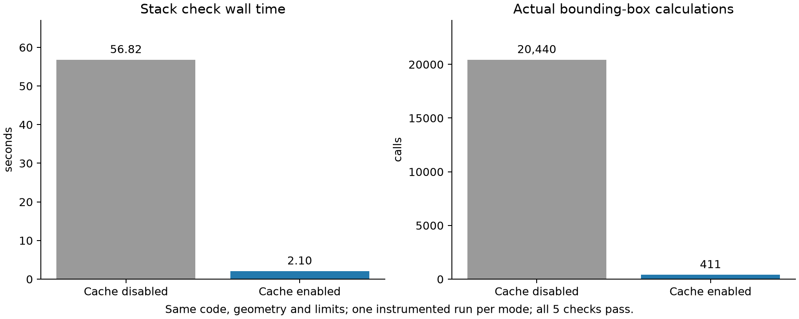

# CAD test performance evidence

`test-runtime/results.json` records fresh-process full-suite wall times. Each
configuration runs three times, sequentially, with rotating order. The JUnit
reports retain every test result; logs include the slowest tests. The earlier
742-second runtime was supplied by the user and is explicitly distinguished
from controlled measurements of the optimized code.

Reproduce the suite experiment:

```bash
uv run python tools/benchmark_tests.py
```

Isolate bounds reuse using the same geometry, checks and limits:

```bash
uv run python tools/profile_stack.py --uncached --output benchmarks/test-runtime/stack-uncached.json
uv run python tools/profile_stack.py --output benchmarks/test-runtime/stack-cached.json
```

The profiler builds the assembly before timing, counts actual
`Shape.bounding_box()` calls during `check_stack`, and verifies all five stack
checks. Uncached mode replaces only the query context's bounds reuse with a
fresh bounding-box calculation on each request. Run modes separately with no
other CAD jobs running. These timings include profiling instrumentation and
should be compared with each other, not directly with uninstrumented test times.

Default `uv run pytest` uses four isolated worker processes. Serial debugging
is available through `uv run pytest -n 0`; two workers can be selected with
`uv run pytest -n 2`. Geometry and numerical acceptance limits are identical.

## Measured full-suite results

Three trials per configuration; each ran the identical 104 tests without
failures, errors or skips. Wall times include process/worker startup and teardown.

| Mode | Minimum | Median | Maximum |
| --- | ---: | ---: | ---: |
| Serial (`-n 0`) | 92.13 s | 94.00 s | 94.54 s |
| Two workers | 51.46 s | 51.98 s | 52.94 s |
| Four workers (default) | 51.84 s | 52.36 s | 52.73 s |

Parallelism provides a controlled 1.80× speedup over the optimized serial run.
Two and four workers are effectively tied here; `-n 2` uses fewer processes.
The long assembly-motion test (about 44–46 s of call time) dominates the
parallel critical path. Further gains need cheaper motion queries or finer
independent test cases; adding workers alone is unlikely to help much.

The reported 742 s versus measured 52.36 s is about 14.2× faster (92.9% less
wall time), but the earlier value was not rerun under these controlled
conditions. It should not be treated as a controlled before/after benchmark.

The wrong-key-phase negative test now completes in about 0.8 s; it still
rejects the incorrect key alignment. Motion queries stop once they have a
collision or uncertified-pair witness, while each report check still runs.
Regression tests also cover nested-compound collisions and cache invalidation
on placement/topology replacement.



Regenerate plots from saved results without rerunning the suite:

```bash
uv run python tools/benchmark_tests.py --plot-only
```

## Controlled bounds-cache profile

One instrumented run per mode, same optimized code and geometry; assembly
construction is excluded from these section timings. All five stack checks
passed in both modes.

| Bounds reuse | Stack time | Bounding-box calls | Time in bounding boxes |
| --- | ---: | ---: | ---: |
| Disabled | 56.82 s | 20,440 | 55.31 s |
| Enabled | 2.10 s | 411 | 0.64 s |

Bounds reuse alone made this section 27.1× faster and removed 98.0% of actual
bounding-box calculations. Remaining calculations include transient query
geometry and code outside the shared context.


