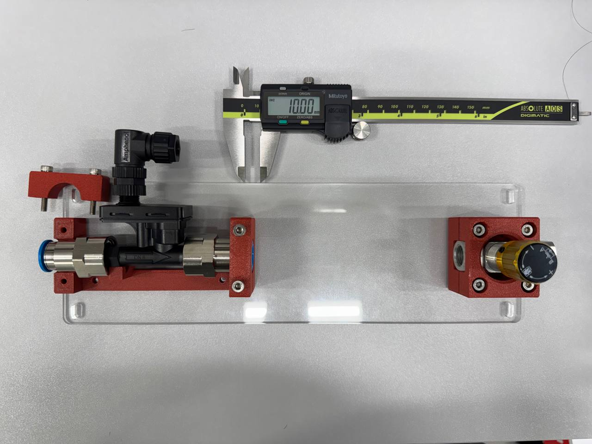
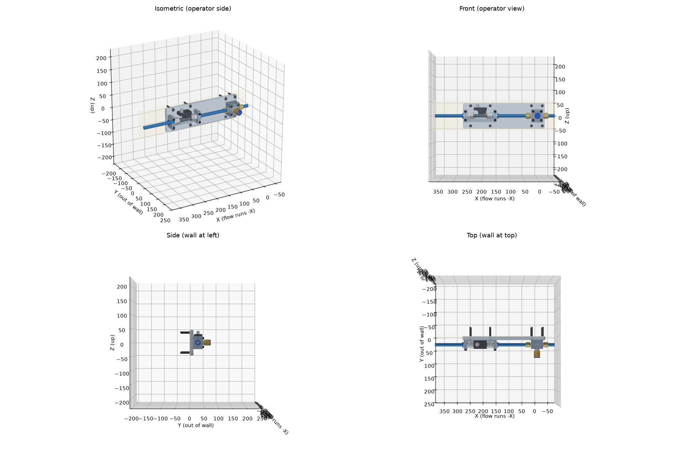
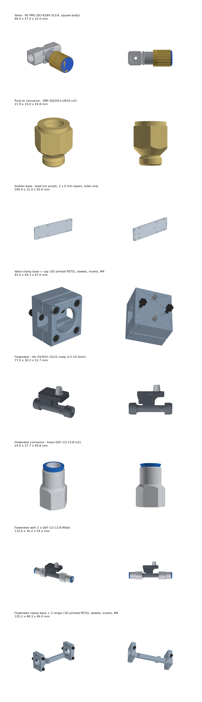
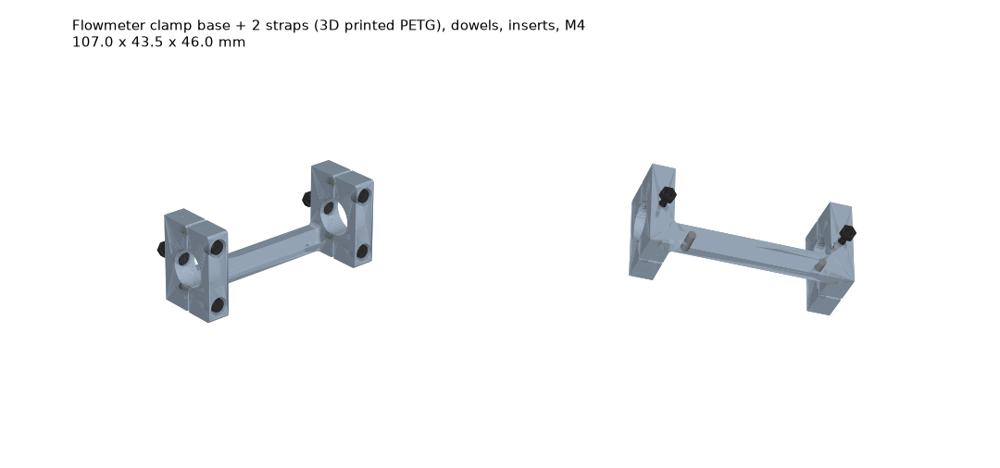

# Iteration 1: prototype build report

| | |
|---|---|
| Product | Wall-mounted water flow station: ifm SV3051 flowmeter → 12 mm link tube → RS 283-8289 needle valve |
| Iteration | 1, first physical prototype (one set) |
| Design revision built | git tag `iter-1` = commit `6c41120` (2026-11-23), "Generate the STEP files in output/". The released `step.zip` matches the exports at that commit byte for byte |
| Build scope | Dry fit with screws tightened. No water, no pressure test |
| Report date | 2026-11-25 |

---

## 1. Summary

The first prototype set was printed, laser-cut and assembled from the
revision 1 CAD. The **valve clamp worked as designed**. The **flowmeter clamp
did not fit**: the bar between its two pedestals was 96.3 mm, but the real
flowmeter with its two Festo QSF fittings needs about 80 mm. The straps
therefore landed beyond the round body of the fittings.

The root cause was in the **model of the bought-in QSF fitting, not in
manufacturing**:

1. **Wrong dimensions.** The QSF was modelled from the RS/TraceParts web
   3D model. The real part has a shorter hex section (18 mm, not 21) and a
   shorter round body (11 mm, not 15.3).
2. **Wrong axial stop.** The model placed each QSF against a shoulder on the
   meter that does not exist. A parallel G1/2 thread keeps turning until the
   meter end face bottoms in the QSF port, which is 3 mm further in on each
   side.

Together these two errors account for the 16 mm. Both are corrected in the
model, and a new design check now places the QSF by its real stop. The
prototype also showed that three features were over-designed: the
flowmeter roll-stop pad, the second lower bar, and the two-layer plate. All
three have been removed for iteration 2.

**Verdict:** the clamp-module concept is confirmed (printed bases on dowels,
straps gripping round surfaces only). The flowmeter clamp and the station
plate must be remade to the corrected model before any wet testing.

*Iteration 1 prototype. Left: flowmeter clamp base with the SV3051, two QSF
fittings and the Amphenol M12 elbow; one strap is removed (top left). Right:
valve clamp with the needle valve. The KQ2 fittings and the link tube are
not fitted.*

---

## 2. Configuration as built

### 2.1 Made parts

| Part | Process / material | Envelope (mm) | Qty | Notes |
|---|---|---|---|---|
| Station plate, wall layer | Laser-cut acrylic, 6 mm | 300 × 92 × 6 | 1 | Two-layer plate, holes only |
| Station plate, front layer | Laser-cut acrylic, 6 mm | 300 × 92 × 6 | 1 | |
| Valve clamp base | FDM, PETG | 42 × 17.5 × 47 | 1 | |
| Valve clamp cap | FDM, PETG | 42 × 14.6 × 47 | 1 | Ø9.5 counterbores for the screw heads |
| Flowmeter clamp base | FDM, PETG | 120.3 × 22.4 × 46 | 1 | 2 pedestals, 96.3 mm between them, roll-stop pad and lower bar |
| Flowmeter clamp strap | FDM, PETG | 12 × 16 × 46 | 2 | No counterbore; heads stand proud |

### 2.2 Bought-in parts

| Part | Qty | Fitted on the prototype |
|---|---|---|
| ifm SV3051 vortex flowmeter | 1 | Yes |
| Festo QSF-1/2-12-B, G1/2 female push-in | 2 | Yes |
| Amphenol LTW MSAP-04BFFC-SR7001 M12 elbow | 1 | Yes (not yet in the revision 1 CAD; modelled later the same day) |
| RS PRO 283-8289 needle valve (Tognella FT 1251/2-01-14) | 1 | Yes |
| SMC KQ2H12-U02A push-in, G1/4 | 2 | **No** |
| 12 × 8 mm tube: link 140.3 mm, inlet, outlet | 3 | **No** |
| G1/2 flat sealing washer | 2 | Not recorded |

### 2.3 Hardware and settings in revision 1

- 4 × dowel pin Ø4 m6 × 12 locate the two clamp bases on the plate.
- 4 × M4 screws into captive nuts fix the clamp bases (0.2 N·m).
- 8 × M4 screws with washers into heat-set inserts close the cap and the
  straps (0.5 N·m).
- 8 × M6 wall screws hold the plate.
- 66 design checks in `assembly.py` passed at this revision.

---

## 3. Observations

| # | Area | Observation | Result |
|---|---|---|---|
| O1 | Valve clamp | Base, cap, dowels and inserts assembled. The valve body sat correctly and the clamp held it. | **Pass** |
| O2 | Flowmeter clamp length | Bar between the pedestals is 96.3 mm. The real flowmeter + QSF set needs about 80 mm. The straps could not seat on the round body of the QSF. | **Fail** |
| O3 | QSF fitting dimensions | Caliper readings of the real QSF and of the fitted set differ from the model by 3 to 7.6 mm (Appendix C). | **Fail** (model error) |
| O4 | Flowmeter stability | Strap friction alone held the meter level. Turning the meter in its straps took a very strong torque by hand. The roll-stop pad did no useful work. | Pad not needed |
| O5 | Base bar strength | The lower bar of the flowmeter base did not break when bent hard by hand. A second bar is not needed. | Pass (qualitative) |
| O6 | Station plate | Two 6 mm layers gave no benefit over one plate. One layer is enough. | Simplify |
| O7 | Scope | KQ2 fittings, tubes and water were not fitted, so the fluid tests (leak, pull, thermal, alignment) were not run. | Not tested |

### 3.1 Status against the test plan (README "Tests on real parts")

| # | Test | Status |
|---|---|---|
| 1 | Measure the bought-in parts | Partial: QSF and the fitted meter set were measured **after** the build. Valve, KQ2 and washer not recorded |
| 2 | Plate coupon | Not run (the full plate was cut) |
| 3 | Print coupon | Not run (full parts were printed) |
| 4 | Insert pull-out | Not run |
| 5 | Dry fit | **Done.** Valve clamp passed; flowmeter clamp failed (O2) |
| 6 | Clamp gap | Not recorded |
| 7 | Leak, 6 bar, 30 min | Not run |
| 8 | Torque retention | Not run |
| 9 | Pull and twist | Informal only: the meter resisted twisting by hand (O4) |
| 10 | Valve use | Not run |
| 11 | Thermal | Not run |
| 12 | Alignment | Not run (no link tube) |

---

## 4. Issues and risks

### 4.1 Issues found (closed in the model)

| ID | Issue | Root cause | Correction | Ref |
|---|---|---|---|---|
| I1 | Flowmeter clamp 16 mm too long | (a) QSF hex and round-body lengths taken from the RS/TraceParts web model, which differs from the real part. (b) QSF placed at the end of the meter thread, where the meter has no shoulder | QSF re-modelled from caliper values. Each QSF is now placed where the meter end face bottoms on the washer at the port floor. Pedestals 83 mm apart (base 107 mm overall) | `a849c80` |
| I2 | The design checks did not catch I1 | The KQ2 fittings had a thread-engagement check but the QSF fittings had none. The RS mesh is solid inside, so the port depth was never compared | New check: the QSF bottoms on the meter end face through the washer, with a negative test that moves a fitting ±1 mm | `a849c80` |
| I3 | Roll-stop pad and second lower bar not needed | Over-design; strap friction is enough (O4, O5) | Removed. Dowels moved from ±40 to ±34 mm | `81890b0` |
| I4 | Two-layer plate not needed | Over-design (O6) | One 12 mm acrylic plate with 6 mm pockets for the nuts and M6 heads. Now carries three stacked sets | `e1337c6`, `442975d` |

**Why the target is 83 mm and not 80 mm:** the QSF hex ends 40.5 mm from the
meter centre. A 12 mm strap must clear the hex by 1 mm and needs ±1 mm of
axial float, which puts the pedestal inner faces at ±41.5 mm. The measured
80 ± 3 mm covers 83 mm.

### 4.2 Open risks for iteration 2

| ID | Risk | Effect if wrong | Mitigation |
|---|---|---|---|
| R1 | G1/2 washer thickness is **assumed** to be 1.0 mm (`FC.WASHER_T`) | Both QSF fittings and both straps shift by the difference | Measure the fitted washer before printing |
| R2 | QSF collar diameter next to the release ring is **estimated** at Ø19.3 (RS model). The strap overhangs it | If it is over Ø20.9, the strap touches the collar | Measure with calipers |
| R3 | Strap axial float is ±1.0 mm, exactly at its ±1.0 mm limit | Small stack-ups may put the strap on the hex | Measure R1 and R2; print the strap coupon first |
| R4 | Strap counterbores (Ø9.5 in a 12 mm strap) leave 1.25 mm walls against a 1.2 mm minimum | Thin walls may print poorly or split | Inspect the first print; check walls on a coupon |
| R5 | The iteration 1 plate cannot be reused | Dowel holes moved and the plate design changed | Re-cut the plate from the current `base_plate.dxf` |
| R6 | The seal at the meter end faces is open: the ifm model shows a seal-ring groove, but the design uses a flat washer | Leak at the G1/2 joints | Confirm from the real meter or ifm manual 11592037 before the leak test |
| R7 | Material allowables, friction and process tolerances are estimates | Clamp pressures, gaps and strain margins may differ in reality | Plate and print coupons, then tests 6–12 |
| R8 | No fluid test yet | Leaks, tube strain and thermal behaviour unproven | Full test plan in iteration 2 |
| R9 | `cad_compare.py flowmeter_connector` now fails against the RS model | Expected, because caliper values override the vendor mesh. Could be mistaken for a regression | Documented in the part file and the README |

---

## 5. Lessons learned and actions

### 5.1 Lessons learned

1. **Measure bought-in parts before designing around them.** The RS web 3D
   model is a simplified TraceParts preview. It was right in diameter but
   wrong in axial lengths. Test 1 (calipers) was in the plan but was done
   after the parts were printed. A 10-minute measurement would have saved a
   print.
2. **Place every threaded joint at its physical stop.** A parallel G thread
   runs until a face or a floor stops it, not to a nominal thread length.
   Every fitting needs an engagement check. The KQ2 fittings had one and the
   QSF fittings did not.
3. **Print coupons before full parts.** Tests 2 and 3 (plate and print
   coupons) were skipped. A 20 mm clamp slice tries the fit at a fraction of
   the time and material.
4. **A prototype removes over-design quickly.** The pad, the second bar and
   the second plate layer were all shown to be unnecessary in one dry fit.
5. **Tag what you build.** The built revision had to be found afterwards by
   matching the STEP files to commits. Tag each released revision.
6. **A screw can thread straight into a printed hole.** A hole slightly
   smaller than the screw lets the screw cut its own thread and the PETG grips
   it, with no insert needed. It wears each time the screw comes out, though,
   so it only suits joints that are assembled once. Joints that are opened
   for service (the valve cap and the flowmeter straps) keep heat-set inserts.
   The design rule stays: no screws into tapped plastic on serviced joints.
7. **Fillets and chamfers strengthen 90° corners.** A sharp inside corner
   concentrates stress and is where a printed part cracks first. A fillet or
   chamfer at the root adds material there and spreads the load, for example
   where a pedestal meets the bar. Keep them off the faces that locate or
   clamp a part, or they change the fit.
8. **Counterbores give clearance.** Recessing the screw head and washer
   keeps them out of the way of neighbouring parts and tools, gives the head
   a flat seat, and allows shorter screws. On the flowmeter straps they make
   the clamp 4.8 mm shallower and shorten the screws from M4 × 30 to M4 × 25.
   The cost is a thinner wall around the counterbore (R4).
9. **What worked:** the modular clamp concept (dowel-located bases, round-only
   gripping, heat-set inserts) and the valve clamp design carry over unchanged.

### 5.2 Actions

| ID | Action | Status | Ref |
|---|---|---|---|
| A1 | Re-model the QSF from caliper values | Done | `a849c80` |
| A2 | Place the QSF by its real stop; add the engagement check and negative test | Done | `a849c80` |
| A3 | Remove the roll-stop pad and second lower bar; move the dowels to ±34 mm | Done | `81890b0` |
| A4 | One 12 mm pocketed plate for three stacked sets, 6 wall screws | Done | `e1337c6`, `442975d`, `f6ba558` |
| A5 | Counterbore the flowmeter straps like the valve cap (Ø9.5 × 5.5, M4 × 25 screws) | In progress | — |
| A6 | Measure the washer thickness (R1) and the QSF collar diameter (R2); update `WASHER_T` | Open | — |
| A7 | Measure the valve body, KQ2 hex and meter end faces (rest of test 1) | Open | — |
| A8 | Cut the plate coupon and print the clamp coupons (tests 2–4) | Open | — |
| A9 | Confirm the meter end-face seal (R6) and order washers or O-rings | Open | — |
| A10 | Re-cut the plate; reprint the flowmeter base and straps from the corrected model | Open | — |
| A11 | Iteration 2 build with KQ2 fittings and tubes; run tests 5–12, including the 6 bar leak test | Open | — |
| A12 | Tag the built revisions in git (`iter-1` at `6c41120`, and `iter-2` when released) | `iter-1` done (pushed to origin); `iter-2` open | tag `iter-1` |
| A13 | Add root fillets or chamfers at the inside 90° corners of the printed parts, away from the locating and clamping faces | Open | — |

---

## Appendices

### A. Design revision trail

| Commit | Date | Change |
|---|---|---|
| `6c41120` | 2026-11-23 | **Iteration 1 as built**: STEP export used for manufacture |
| `c724572`, `033cceb` | 2026-11-23 | M12 elbow modelled and fitted to the SV3051 |
| `e1337c6` | 2026-11-24 | Station base becomes one pocketed 12 mm plate |
| `442975d`, `f6ba558` | 2026-11-24 | Three sets stacked on one plate; 6 wall screws |
| `0b2ba07` | 2026-11-24 | Roll-stop pad and second bar added (removed again in `81890b0`) |
| `a849c80` | 2026-11-25 | QSF from caliper values, placed by its real stop (I1, I2) |
| `81890b0` | 2026-11-25 | Pad and second bar removed (I3) |

### B. Iteration 1 CAD

Corrected flowmeter clamp base for iteration 2: 107 mm overall, 83 mm
between the pedestals, no pad, one bar:

### C. QSF and flowmeter measurements (calipers, ±0.5 mm)

Measured on 2026-11-25 on the real SV3051 with both QSF fittings screwed on.

| | Feature | Rev 1 model | Measured | Δ |
|---|---|---|---|---|
| A | Port face to port face (faces against the meter) | 51.0 | 45 | −6.0 |
| B | Hex end to hex end (outer ends of the hexes) | 93.0 | 80 ± 3 | −13 |
| C | Overall, release-ring end to release-ring end | 132.6 | 125 | −7.6 |
| D | One QSF: port face to end of hex, including chamfer | 21.0 | 18 | −3.0 |
| E | One QSF: length of the round Ø20.8 section | 15.3 | 11 | −4.3 |
| F | One QSF alone: port face to release-ring end | 40.8 | 40 | −0.8 |

Derived from A: the meter end face sits 16 mm inside each QSF port, so the
port floor is 17 mm deep with a 1 mm washer (catalogue L2 = 14 mm is the
usable thread length, not the port depth).

### D. Iteration 1 bill of materials (from `step.zip`, `bom.csv`)

| File | Component | Qty |
|---|---|---|
| 01 | Needle valve RS 283-8289 (Tognella FT 1251/2-01-14) | 1 |
| 02 | Push-in fitting SMC KQ2H12-U02A | 2 |
| 03 | Vortex flowmeter ifm SV3051 | 1 |
| 04 | Push-in fitting Festo QSF-1/2-12-B | 2 |
| 05 | Station plate, wall layer (acrylic, laser-cut) | 1 |
| 06 | Station plate, front layer (acrylic, laser-cut) | 1 |
| 07 | Valve clamp base (PETG, printed) | 1 |
| 08 | Valve clamp cap (PETG, printed) | 1 |
| 09 | Flowmeter clamp base, 2 pedestals + pad (PETG, printed) | 1 |
| 10 | Flowmeter clamp strap (PETG, printed) | 2 |
| 11 | Tube 12 × 8, link (cut stop-to-stop) | 1 |
| 12 | Tube 12 × 8, inlet straight run | 1 |
| 13 | Tube 12 × 8, outlet stub | 1 |
| 14 | M4 ISO 4762 cap screw, cap/strap | 8 |
| 15 | M4 ISO 4762 cap screw, base to plate | 4 |
| 16 | M4 DIN 125 washer | 8 |
| 17 | M4 heat-set insert | 8 |
| 18 | M4 hex nut, captive in plate | 4 |
| 19 | Dowel pin Ø4 m6 × 12 | 4 |
| 20 | M6 wall screw | 8 |

The released STEP files for this revision can be regenerated with
`git checkout 6c41120 && uv run python tools/export_step.py`.
